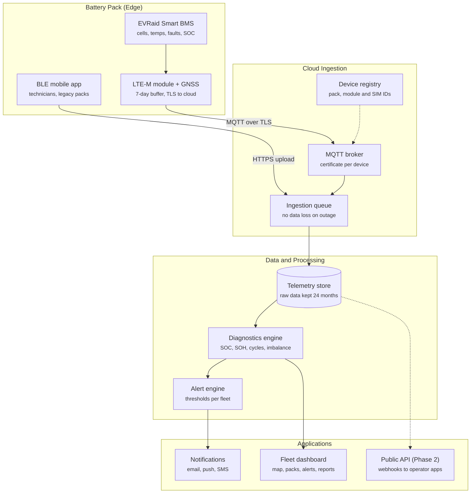

# EVRaid Battery Fleet Management Platform — PRD (MVP)

**Date:** Oct 26, 2026  
**Author:** @Sherif Diab  

---

## 1. Overview

EVRaid will launch a cloud fleet management platform that lets light-mobility operators track the health, location, and value of every EVRaid battery pack in real time, sold as a per-battery monthly subscription.

* **Problem:** Scooter and golf-car operators run hundreds of battery packs but see them only when a technician connects by Bluetooth. Today, the EVRaid BMS mobile app pushes data to the cloud only when a phone is nearby. Operators cannot see failing packs early, cannot locate lost or stolen packs, and cannot value their battery assets.
* **Vision:** Every EVRaid pack reports continuously over a cellular module. The platform turns that data into diagnostics (SOC, SOH, cycle count, remaining life), alerts, and later AI predictions (degradation, predictive maintenance, residual value, usage recommendations).
* **Why EVRaid:** EVRaid owns its BMS IP for LFP and NMC, so it controls the firmware, the data, and the telemetry protocol end to end. More than 700 packs with EVRaid BMS are already deployed in Egypt, giving an installed base and a data head start. The platform also protects EVRaid directly: field data supports warranty decisions and feeds BMS R&D.

---

## 2. Goals, Non-goals and Success Metrics

The MVP succeeds when one paying light-mobility operator runs its whole EVRaid fleet on the platform and acts on its alerts.

### Goals (MVP)
* Collect telemetry from every connected pack continuously, without a phone in range.
* Give operators a live view of SOC, SOH, cycle count, temperature, location, and alerts for each pack and for the whole fleet.
* Detect safety and abuse events early enough for an operator to act.
* Start building the historical dataset needed for the AI phase.

### Non-goals (MVP)
* AI-based predictions (degradation, RUL, residual value). These come in Phase 3, once enough field data exists.
* Support for non-EVRaid BMS.
* Battery-as-a-Service billing and EU battery passport.
* Replacing the operator's own fleet app; the platform exposes data to it instead (Phase 2 API).

### Success Metrics

| Metric | Target | Measured over |
| :--- | :--- | :--- |
| **Packs reporting daily** | $> 95\%$ of connected packs | Rolling 7 days |
| **Telemetry latency (pack to dashboard)** | $< 60\text{ s}$ at default interval | p95 |
| **SOC accuracy vs reference test** | $\pm 5\%$ | Bench validation |
| **SOH accuracy vs capacity test** | $\pm 5\%$ | Sample of 20 packs |
| **Critical alerts acknowledged by operator** | $> 90\%$ within $1\text{ h}$ | Monthly |
| **Paying pilot customers** | 1 by end of MVP, 3 within 6 months | Contracts |

> *Note: These targets are proposals for the team to confirm.*

---

## 3. Target Users and Personas

The first customers are e-scooter and light-mobility operators such as Rabbit Mobility and Loop; golf-car fleets and e-bus operators follow.

| Persona | Organisation | Needs from the platform | Main screens |
| :--- | :--- | :--- | :--- |
| **Fleet operations manager** | Operator | See which packs need charging, swapping or service; locate packs | Fleet map, pack list, alerts |
| **Field technician** | Operator or EVRaid | Know which pack to fix and why; run diagnostics on site | Work orders, pack detail, BLE app |
| **Finance / management** | Operator | Fleet health trend, asset value, cost per km | Fleet summary, reports |
| **EVRaid support engineer** | EVRaid | Investigate faults, decide warranty claims, push firmware | Admin console, raw telemetry |
| **EVRaid R&D** | EVRaid | Field degradation data by cell, chemistry, and supplier | Data export, analytics |
| **Operator's IT team** | Operator | Pull data into their own fleet system | API (Phase 2) |

---

## 4. Scope by Phase

This PRD specifies Phase 1 (MVP) in detail; Phases 2–4 are listed so the MVP architecture does not block them.

| Phase | Theme | Scope | Gate to next phase |
| :--- | :--- | :--- | :--- |
| **1. MVP** | **Connect and see** | 4G/LTE-M module, telemetry pipeline, multi-tenant dashboard, physics-based SOC/SOH, cycle count, GPS, alerts | 1 pilot operator live; $95\%$ packs reporting daily |
| **2. Operate** | **Act on the fleet** | OTA BMS firmware, remote lock/unlock, geofencing, work orders, charging recommendations, public API, and webhooks | 3 paying operators; OTA proven on pilot fleet |
| **3. Predict** | **AI layer** | SOH forecasting, remaining useful life, predictive maintenance, efficiency scoring, usage recommendations, residual value | $> 12$ months of field data across $\ge 1,000$ packs |
| **4. Ecosystem** | **New revenue** | Battery-as-a-Service billing, EU digital battery passport, second-life grading, white-label, adapters for third-party BMS | Regulatory review for EU; BaaS financing partner |

> **Note on Funding Scope:** The Phase 3 AI model overlaps the ASRT phase-two grant scope (SOC/SOH estimation and fault prediction). Any separate funding for this platform must keep its outputs and costs distinct from that scope.

---

## 5. MVP Functional Requirements

The MVP has six modules: telemetry ingestion, battery diagnostics, alerts, fleet dashboard, device management, and accounts.  
**Priority:** `P0` = must ship in MVP, `P1` = ship if time allows.

### FR-1: Telemetry Ingestion

| ID | Requirement | Priority |
| :--- | :--- | :--- |
| **FR-1.1** | Each pack sends pack voltage, current, all cell voltages, cell/pack temperatures, SOC, BMS fault flags, charge/discharge state, and GPS position | P0 |
| **FR-1.2** | Reporting interval configurable per fleet: default $30\text{ s}$ while in use, $15\text{ min}$ while idle, immediate on fault | P0 |
| **FR-1.3** | Module buffers at least 7 days of data when offline and uploads it in order on reconnection | P0 |
| **FR-1.4** | Every message carries pack serial, BMS firmware version, timestamp (UTC), and sequence number | P0 |
| **FR-1.5** | Existing BLE mobile app keeps uploading for packs without a 4G module, into the same data store | P0 |
| **FR-1.6** | Raw telemetry kept for at least 24 months for AI training | P0 |

### FR-2: Battery Diagnostics (Physics-Based)

| ID | Requirement | Priority |
| :--- | :--- | :--- |
| **FR-2.1** | SOC per pack, from BMS coulomb counting with OCV correction at rest | P0 |
| **FR-2.2** | SOH (capacity) per pack, estimated from full or partial charge cycles against rated capacity | P0 |
| **FR-2.3** | SOH (resistance) per pack, estimated from voltage response to current steps | P1 |
| **FR-2.4** | Equivalent full cycle count and cumulative $\text{Ah} / \text{kWh}$ throughput | P0 |
| **FR-2.5** | Cell imbalance: max-min cell voltage, trended over time, weakest cell identified | P0 |
| **FR-2.6** | Estimated remaining life in cycles, using a simple linear fade model until the AI model replaces it | P1 |
| **FR-2.7** | Usage profile per pack: depth of discharge distribution, temperature exposure, charge rate, time at high SOC | P0 |
| **FR-2.8** | Health grade per pack ($\text{A/B/C/D}$) from SOH and fault history, for operators who do not read raw values | P0 |

### FR-3: Alerts

| ID | Alert | Severity | Priority |
| :--- | :--- | :--- | :--- |
| **FR-3.1** | Over-temperature or abnormal temperature rise rate (thermal runaway early warning) | Critical | P0 |
| **FR-3.2** | Cell over/under-voltage, sudden cell voltage drop | Critical | P0 |
| **FR-3.3** | Cell imbalance above threshold | Warning | P0 |
| **FR-3.4** | Deep discharge, over-current, charging with non-approved charger profile (abuse) | Warning | P0 |
| **FR-3.5** | SOH below fleet threshold (e.g., $80\%$) | Info | P0 |
| **FR-3.6** | Pack not reporting for longer than set time | Warning | P0 |
| **FR-3.7** | Pack moved outside operating area | Warning | P1 |

* Alerts are delivered in the dashboard, by email, and by push or SMS for critical alerts.
* Thresholds are set per fleet with EVRaid defaults.
* Each alert can be acknowledged, assigned, and closed.
* All abuse events are stored permanently as warranty evidence.

### FR-4: Fleet Dashboard (Web)

* **Fleet overview:** number of packs, health grade distribution, open alerts, packs needing charge.
* **Map:** pack locations with filters by status, health grade, and alert.
* **Pack list:** search and sort by SOH, SOC, cycles, last seen.
* **Pack detail:** live values, cell voltages chart, SOH and cycle history, alert history, location history.
* **Reports:** monthly fleet health report exportable to PDF and CSV.
* **Localization:** Interface in English and Arabic (P1 for Arabic).

### FR-5: Device Management

* Register a pack by serial number or QR code and assign it to a customer and fleet.
* Link 4G module ID, SIM ID, and BMS serial to one pack record.
* Show module firmware version and connectivity status.
* Prepare the data model for OTA updates in Phase 2 (no OTA in MVP).

### FR-6: Accounts and Access

* **Multi-tenant:** each operator sees only its own fleets.
* **Roles:** EVRaid super-admin, EVRaid support, customer admin, operations, technician, viewer.
* **Security:** Login by email and password with two-factor authentication for admin roles.
* **Audit trail:** Audit log of user actions on packs and settings.

---

## 6. Hardware and Connectivity Requirements (4G Module)

The telematics module should use LTE-M (Cat-M1) with 2G fallback and built-in GNSS, connected to the EVRaid BMS over CAN or UART. LTE-M costs less than full 4G in module price, data plan, and standby power; the 2G fallback covers areas with weak LTE-M coverage.

| Parameter | Requirement |
| :--- | :--- |
| **Cellular** | LTE-M (Cat-M1), NB-IoT optional, 2G fallback; Egyptian operators to be confirmed for LTE-M |
| **SIM** | eSIM or multi-network IoT SIM, managed remotely |
| **Positioning** | GNSS (GPS + at least one other constellation) |
| **BMS interface** | CAN (preferred, matches Smart BMS) or UART |
| **Storage** | Local buffer for $\ge 7$ days of telemetry |
| **Standby power** | Low enough to keep a stored pack under $1\%$ SOC loss per week from the module (to be validated) |
| **Supply** | From pack, $36\text{--}60\text{ V}$ input range across the BMS family |
| **Protection** | IP67 when integrated in the pack enclosure |
| **Security** | Secure boot, unique device certificate, TLS 1.2+ to cloud |
| **Firmware** | Remotely updatable module firmware; BMS OTA pass-through ready for Phase 2 |
| **Form factor** | Integrated in new packs; retrofit add-on for the installed base |

### Open Hardware Decisions
* Integrated PCB inside the BMS versus separate module board.
* Retrofit plan and cost for the 700+ deployed packs.
* Target bill-of-materials cost per module, which sets the subscription floor price.

---

## 7. System Architecture and Data Model

Telemetry flows one way, from the BMS through the LTE-M module and a queue-based ingestion layer into a single telemetry store, which feeds diagnostics, alerts, and the dashboard.

Packs without a module keep uploading through the BLE app into the same queue. Phase 3 AI models will read the telemetry store and write predictions beside the physics-based diagnostics, so the MVP data model must keep raw samples, not only summaries.

### Core Data Model

| Entity | Key Fields |
| :--- | :--- |
| **Customer** | ID, name, country, subscription tier |
| **Fleet** | ID, customer, reporting interval, alert thresholds |
| **Pack** | Serial, fleet, chemistry (LFP/NMC), series count, rated capacity (Ah), BMS firmware version |
| **Module** | IMEI, SIM ID, firmware version, linked pack |
| **Telemetry sample** | Pack, UTC timestamp, sequence number, pack and cell voltages, current, temperatures, SOC, fault flags, GPS |
| **Diagnostic snapshot** | Pack, date, SOC, SOH (capacity and resistance), equivalent cycles, Ah throughput, imbalance, health grade |
| **Alert** | Pack, type, severity, status, assignee, raised / acknowledged / closed times |
| **User** | Customer, role, two-factor status |

---

## 8. Non-functional Requirements: Security, Privacy, Reliability

Security is a launch requirement, not a later phase, because Phase 2 adds remote lock and OTA: a compromised platform could disable a whole fleet.

| Area | Requirement |
| :--- | :--- |
| **Device identity** | Unique X.509 certificate per module; revocable from the admin console |
| **Transport** | MQTT over TLS 1.2+, mutual authentication |
| **Commands (Phase 2)** | Signed commands and signed firmware images; two-person approval for fleet-wide lock or OTA |
| **Data isolation** | Strict tenant separation enforced at the database and API layer |
| **Data ownership** | Contracts state that EVRaid may use anonymised telemetry for model training and product improvement |
| **Privacy** | Location data treated as potentially personal under Egypt's Personal Data Protection Law (No. 151 of 2020); GDPR applies for EU customers; location history retention configurable per customer |
| **Availability** | $99.5\%$ monthly uptime for dashboard and ingestion |
| **Scale** | Architecture sized for 10,000 packs in year one and 100,000 without redesign |
| **Data loss** | No telemetry loss under cloud outage, via device buffering and queue-based ingestion |
| **Backups** | Daily backups, 30-day retention, tested restore |
| **Standards to align with** | ISO/SAE 21434 practices for the device and command path |

> *Legal review of the privacy and data-ownership terms is needed before the first customer contract.*

---

## 9. Business Model and Pricing Tiers

Revenue comes from the telematics module (one-time, or bundled into the pack price) plus a monthly subscription per connected pack. Prices are to be set once module BOM and data-plan cost are known.

| Tier | Available from | Includes | Price per pack per month |
| :--- | :--- | :--- | :--- |
| **Basic** | Phase 1 | Live monitoring, SOC/SOH, cycle count, GPS, alerts, monthly report | To be set |
| **Pro** | Phase 2–3 | Basic + OTA, remote lock, work orders, API, AI predictions, residual value | To be set |
| **Enterprise** | Phase 4 | Pro + Battery-as-a-Service, battery passport, white-label, dedicated support | Custom |

### Pricing Inputs to Confirm
* Module BOM cost.
* SIM data cost per pack per month.
* Cloud cost per pack per month.
* Extended-warranty value EVRaid can offer to connected packs.
* *Note:* A one-year free Basic tier bundled with new packs could drive adoption and grow the dataset.

---

## 10. Milestones, Dependencies, Risks and Open Questions

A proposed MVP plan of about six months from kickoff; durations are estimates for the team to confirm.

### MVP Milestones
1. **Weeks 0–4:** Module selection, telemetry protocol spec, cloud architecture sign-off. Start storing BLE-app data in the new data store immediately.
2. **Weeks 4–10:** Module prototype on one Smart BMS; ingestion pipeline and data store live.
3. **Weeks 10–16:** Diagnostics engine (SOC, SOH, cycles, imbalance) validated on bench packs; alert engine.
4. **Weeks 16–22:** Fleet dashboard, device management, multi-tenant accounts; security review.
5. **Weeks 22–26:** Pilot with one operator on 50–100 packs; fix and harden.

### Dependencies
* BMS firmware changes to expose all required signals over CAN/UART.
* LTE-M coverage and IoT SIM agreements in Egypt.
* A pilot operator agreeing to install modules and share feedback.
* Bench test setup for SOC/SOH reference measurements.

### Risks and Mitigations

| Risk | Impact | Mitigation |
| :--- | :--- | :--- |
| **Weak LTE-M coverage in operating areas** | Data gaps, failed alerts | 2G fallback; 7-day buffering; coverage test before pilot |
| **Module BOM too high for light-mobility margins** | Low adoption | Retrofit and integrated options; bundle into pack price |
| **SOH estimates inaccurate on partial cycles** | Loss of customer trust | Show confidence level; validate against capacity tests |
| **Security breach after remote lock is added** | Fleet-wide outage | Signed commands, two-person approval, pen test before Phase 2 |
| **Operators prefer their own app** | Dashboard unused | Prioritise API in Phase 2 |
| **Overlap with ASRT grant scope** | Funding compliance issue | Separate outputs and cost lines in any new proposal |

### Open Questions
- [ ] Integrated module in the BMS, or a separate board?
- [ ] Which operator runs the pilot, and on how many packs?
- [ ] Cloud provider and hosting region (Egypt, EU, or both)?
- [ ] Will the platform team build in-house under the software team, or partly outsource?
- [ ] Platform product name?